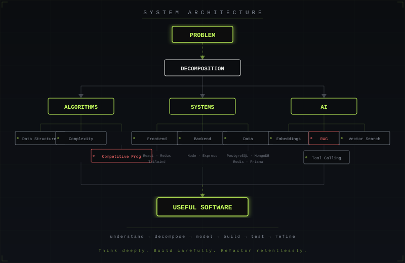
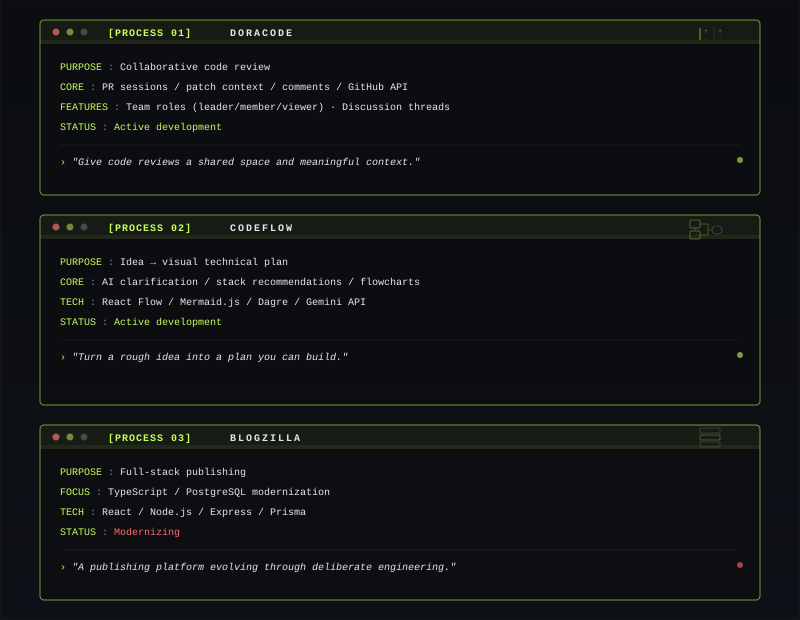

<!-- ╔══════════════════════════════════════════════════════════════════╗ -->
<!-- ║  TERMINAL: LIVING SYSTEM — GitHub Profile README               ║ -->
<!-- ║  Samman Varshney                                               ║ -->
<!-- ╚══════════════════════════════════════════════════════════════════╝ -->

<p align="center">
  
</p>

<!-- Static fallback: replace hero-animation.svg with hero.svg if animations don't render -->

<br/>

<!-- ─────────────────────── TERMINAL INTRODUCTION ─────────────────────── -->

<p align="center">

```
$ whoami
Samman Varshney — CS Engineering Student

$ cat interests.txt
software engineering
competitive programming
generative AI
developer tools

$ cat philosophy.txt
understand → decompose → model → build → test → refine

"I start by understanding the problem and its constraints,
 work toward an approach I can explain, test it against
 edge cases, and refine the implementation until it is
 both correct and maintainable."

$ uptime
Building since 2022 | Status: always learning
```

</p>

<br/>

<!-- ─────────────────────── SYSTEM ARCHITECTURE ─────────────────────── -->

<h2 align="center">
  <code>〔 SYSTEM ARCHITECTURE 〕</code>
</h2>

<p align="center">
  
</p>

<br/>

<!-- ─────────────────────── ACTIVE PROCESSES ─────────────────────── -->

<h2 align="center">
  <code>〔 ACTIVE PROCESSES 〕</code>
</h2>

<p align="center">
  
</p>

<details>
<summary><code>› expand process details</code></summary>
<br/>

| Process       | Description                                                                        | Stack                                                        |
| ------------- | ---------------------------------------------------------------------------------- | ------------------------------------------------------------ |
| **DoraCode**  | Collaborative code review with PR sessions, team roles, and GitHub API integration | React · Node.js · GitHub API                                 |
| **CodeFlow**  | AI-assisted requirement clarification and flowchart generation                     | React Flow · Mermaid.js · Dagre · Gemini API                 |
| **Blogzilla** | Full-stack publishing platform being modernized                                    | React · TypeScript · Node.js · Express · PostgreSQL · Prisma |

</details>

<br/>

<!-- ─────────────────────── TELEMETRY ─────────────────────── -->

<h2 align="center">
  <code>〔 TELEMETRY 〕</code>
</h2>

<p align="center">
  
</p>

<br/>

<!-- ─────────────────────── SKILL MATRIX ─────────────────────── -->

<h2 align="center">
  <code>〔 SKILL MATRIX 〕</code>
</h2>

<p align="center">

```
┌────────────────────────────────────────────────────────────────────┐
│                                                                    │
│  LANGUAGES     Java · Python · JavaScript · TypeScript · SQL       │
│                                                                    │
│  FRONTEND      React · Redux · Redux Saga · Tailwind CSS           │
│                React Flow                                          │
│                                                                    │
│  BACKEND       Node.js · Express                                   │
│                                                                    │
│  DATA          PostgreSQL · MongoDB · Prisma · Redis               │
│                                                                    │
│  GEN AI        LLM APIs · Embeddings · RAG · Vector Search         │
│                Tool Calling · Tokenization & Attention             │
│                                                                    │
└────────────────────────────────────────────────────────────────────┘
```

</p>

<br/>

<!-- ─────────────────────── SIGNAL / LINKS ─────────────────────── -->

<h2 align="center">
  <code>〔 SIGNAL 〕</code>
</h2>

<p align="center">
  <a href="https://github.com/samman-varshney">github</a>&nbsp;·&nbsp;
  <a href="https://linkedin.com/in/samman-varshney-485834284/">linkedin</a>&nbsp;·&nbsp;
  <a href="mailto:sammanvarshney345@gmail.com">email</a>&nbsp;·&nbsp;
  <a href="https://sammanvarshney.vercel.app">portfolio</a>
</p>
<br/>

<p align="center">
  <code style="color: #8B929E; font-size: 10px;">Think deeply. Build carefully. Refactor relentlessly.</code>
</p>

<!-- ─────────────────────── EOF ─────────────────────── -->
